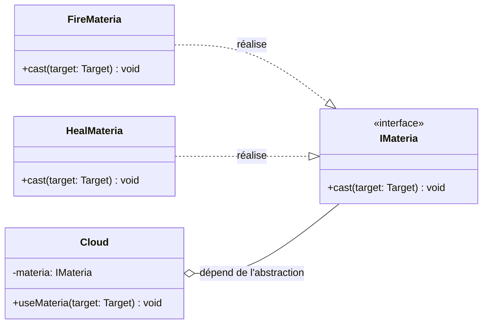
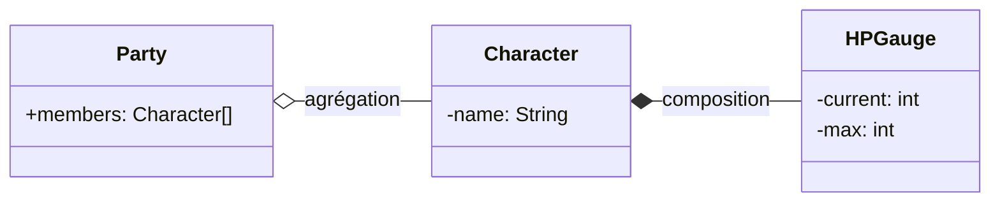
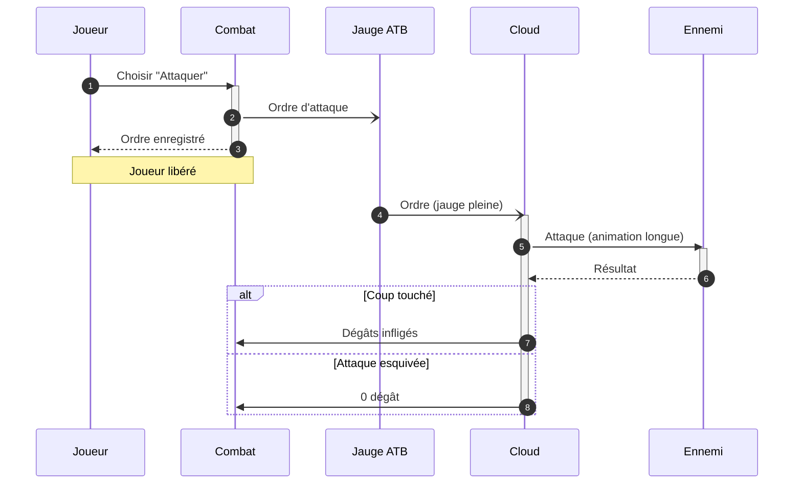
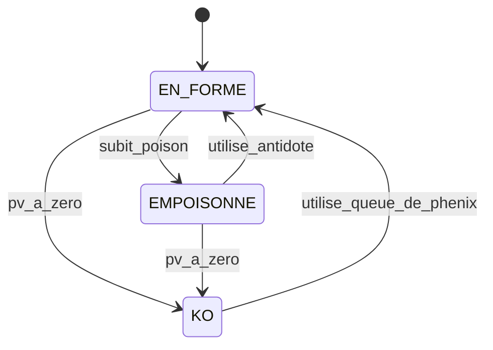

# Récap des diagrammes UML (analogies FFVII)

> UML range ses diagrammes en deux familles : la **photo** (structurel : ce qui existe) et le **film** (comportemental : ce qui se passe).

## Vue d'ensemble

| Diagramme | Question à laquelle il répond | Famille | Analogie FFVII |
|-----------|-------------------------------|---------|----------------|
| **Classes** | Quelles sont les pièces du code, et qui dépend de qui ? | Structurel (photo) | L'équipement et les emplacements de Materia |
| **Séquence** | Dans quel ordre les acteurs échangent-ils des messages ? | Comportemental (film) | Un combat en ATB |
| **États-transitions** | Quels états une même entité peut-elle prendre, et par quel chemin ? | Comportemental (film) | Les statuts d'un personnage (poison, K.O.) |

## 1. Diagramme de classes : la structure du code

**À retenir :** il montre les classes, leurs attributs, leurs méthodes et leurs relations. Il ne montre pas le temps qui passe.

**Analogie :** l'arme de Cloud possède un **emplacement de Materia**. Elle sait qu'elle en a un, mais pas lequel : on peut y insérer Feu, Soin, etc. sans refaire l'arme. C'est le principe de `IOrderRepository` : `OrderService` dépend de l'**interface** (l'emplacement), pas de l'implémentation concrète (la Materia).

| FFVII | Projet MegaShop-B2B |
|-------|---------------------|
| `IMateria` (l'emplacement) | `IOrderRepository` (l'interface) |
| `FireMateria`, `HealMateria` | `PostgresOrderRepository` (une implémentation) |
| `Cloud` | `OrderService` |

### Agrégation vs composition

| Relation | Symbole | Règle | Analogie FFVII |
|----------|---------|-------|----------------|
| **Agrégation** | `o--` (losange vide) | Les parties existent sans le tout | L'équipe : un personnage existe sans elle |
| **Composition** | `*--` (losange plein) | Les parties meurent avec le tout | La jauge de PV : elle disparaît avec le personnage |

## 2. Diagramme de séquence : le déroulement dans le temps

**À retenir :** il montre **qui** envoie **quel message** à **qui**, et **dans quel ordre**. On y distingue les appels synchrones (on attend) des envois asynchrones (on n'attend pas).

**Analogie :** un combat en **ATB**. Le joueur donne un ordre et le jeu répond tout de suite « ordre pris en compte » (équivalent du HTTP 202). L'ordre attend ensuite dans la jauge ATB (la file de messages) jusqu'à ce que le personnage puisse agir. Une action bloquante figerait tout le combat, comme un dialogue de PNJ.

| Flèche | Sens | Dans le combat |
|--------|------|----------------|
| `->>` | Appel synchrone (on attend) | Cloud attend le résultat de l'ennemi |
| `-->>` | Réponse / retour | « Ordre enregistré » |
| `-)` | Message asynchrone (on n'attend pas) | L'ordre part dans la jauge ATB |

| FFVII | Projet MegaShop-B2B |
|-------|---------------------|
| Joueur | Client |
| Combat | API (`OrderService`) |
| Jauge ATB | Message Queue (RabbitMQ) |
| Cloud | `PaymentWorker` |
| Ennemi | Banque |
| « Ordre enregistré » | HTTP 202 Accepted |

## 3. Diagramme d'états-transitions : le cycle de vie d'une entité

**À retenir :** il décrit les états d'**une seule** entité et les événements qui permettent de passer de l'un à l'autre. Toute transition absente du diagramme est **interdite**.

**Analogie :** les statuts d'un personnage. Un personnage K.O. ne peut pas attaquer : il lui faut d'abord une **Queue de phénix**. Chaque flèche porte le nom de l'événement qui la déclenche.

| FFVII | Projet MegaShop-B2B |
|-------|---------------------|
| `KO --> EN_FORME` (Queue de phénix) | `FAILED --> PENDING_PAYMENT` (`retry_payment`) |
| Un K.O. ne peut pas attaquer | `DRAFT --> SHIPPED` est interdit |
| Les étapes de l'histoire à franchir dans l'ordre | `PAID` est le seul passage vers `SHIPPED` |

## Comment choisir le bon diagramme

| Je veux montrer... | Diagramme |
|--------------------|-----------|
| L'architecture du code, les dépendances | Classes |
| Un scénario entre plusieurs acteurs, dans le temps | Séquence |
| Les règles de vie d'un objet, les transitions autorisées | États-transitions |

## Autres diagrammes que tu peux croiser

| Diagramme | Ce qu'il montre | Analogie FFVII |
|-----------|-----------------|----------------|
| **Cas d'utilisation** | Ce que chaque utilisateur peut faire avec le système | Le menu des actions disponibles (Attaquer, Magie, Objet, Fuite) |
| **Activité** | Un flux d'étapes avec décisions, comme un organigramme | L'arbre de décision d'un combat de boss |
| **MCD/MLD (Merise)** | La structure des données (pas de l'UML à proprement parler) | L'inventaire : quels objets existent et comment ils se rattachent |

## Ce qu'on a produit dans ce projet (MegaShop-B2B)

| Fichier | Diagramme |
|---------|-----------|
| `architecture/01_class_diagram.md` | Classes : isolation du Repository |
| `architecture/02_sequence_diagram.md` | Séquence : flux de paiement asynchrone |
| `architecture/03_state_machine.md` | États-transitions : cycle de vie de la commande |
