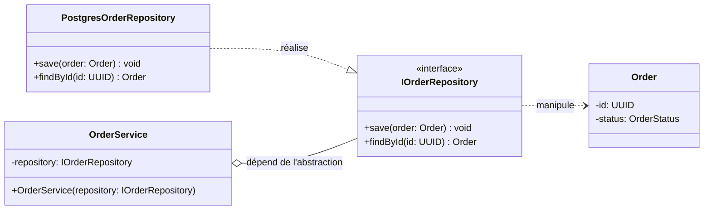

# Diagramme de classes : isolation du Repository

## Objectif

Permettre à `OrderService` de sauvegarder une commande sans jamais connaître PostgreSQL.
`OrderService` dépend d'une **abstraction** (`IOrderRepository`), jamais de l'implémentation concrète (Inversion des Dépendances, le « D » de SOLID).

## Diagramme

## Lecture du diagramme

- `IOrderRepository` est le **contrat** : il expose des opérations métier (`save`, `findById`), sans aucun mot lié à SQL.
- `PostgresOrderRepository` est un détail d'implémentation : c'est le seul endroit qui connaît PostgreSQL.
- `OrderService` reçoit son repository par son constructeur (**injection de dépendances**) et ne référence que l'interface.
- Il n'existe aucune flèche entre `OrderService` et `PostgresOrderRepository`.

## Piège évité

Si `OrderService` faisait `new PostgresOrderRepository()` en interne, il y aurait un couplage technologique fort. Les tests unitaires exigeraient alors une vraie base de données. Avec l'interface, un test peut injecter un faux repository en mémoire.
