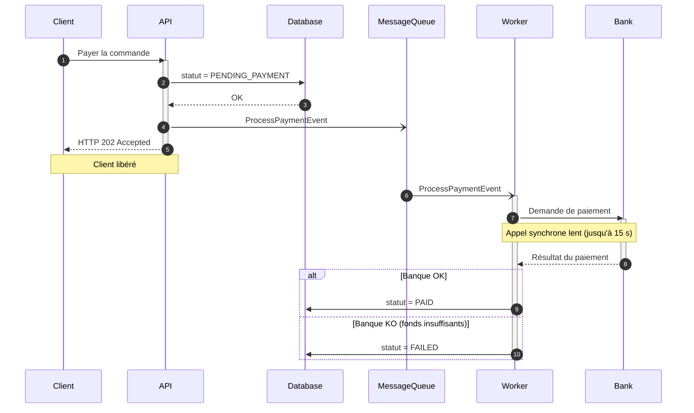

# Diagramme de séquence : flux de paiement asynchrone

## Objectif

Modéliser dans le temps l'orchestration du paiement d'une commande (MegaShop-B2B), en distinguant :

- les appels **synchrones** (l'appelant attend la réponse) ;
- les envois **asynchrones** (l'appelant continue sans attendre).

## Diagramme

## Légende des flèches

| Flèche | Sens                              | Utilisation dans le diagramme                     |
| ------ | --------------------------------- | ------------------------------------------------- |
| `->>`  | Appel synchrone (bloquant)        | Client → API, API → Database, Worker → Bank       |
| `-->>` | Réponse / retour                  | Database → API, API → Client (202), Bank → Worker |
| `-)`   | Message asynchrone (non bloquant) | API → MessageQueue, MessageQueue → Worker         |

## Lecture du diagramme

- Le client reçoit son **HTTP 202** juste après la publication du message, avant que le Worker ait fait quoi que ce soit.
- Le Worker prend le relais de façon découplée : il consomme le message, puis appelle la banque de façon synchrone (lent, mais sans bloquer personne d'autre que lui).
- Le bloc `alt` sépare les deux scénarios : `PAID` si la banque valide, `FAILED si elle refuse.

## Piège évité

Aucune flèche de retour vers le Client n'apparaît après l'appel à la banque. Sinon, le client attendrait jusqu'à 15 secondes et l'architecture redeviendrait bloquante, ce qui annulerait l'intérêt du Message Broker.

## Limite connue (hors périmètre du cahier des charges)

L'API écrit en base (étape 2) puis publie dans RabbitMQ (étape 3) : ce sont deux opérations distinctes. Si l'API plante entre les deux, la commande reste en `PENDING_PAYMENT` sans message associé. Le pattern **Transactional Outbox** répond à ce problème. Il n'est pas modélisé ici, par fidélité au cahier des charges.
