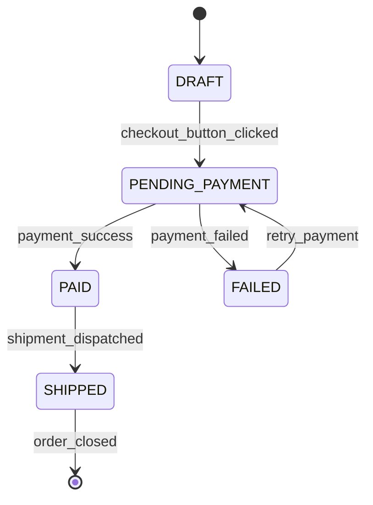

# Diagramme d'états-transitions : cycle de vie d'une commande

## Objectif

Restreindre de façon déterministe le cycle de vie d'une commande.
Il doit être impossible de passer de `DRAFT` à `SHIPPED` sans avoir franchi une étape de paiement validée.

## Diagramme

## Transitions autorisées

| De | Vers | Événement | Déclencheur |
|----|------|-----------|-------------|
| (création) | `DRAFT` | - | Création de la commande |
| `DRAFT` | `PENDING_PAYMENT` | `checkout_button_clicked` | Client, via l'API (`OrderService`) |
| `PENDING_PAYMENT` | `PAID` | `payment_success` | `PaymentWorker`, banque OK |
| `PENDING_PAYMENT` | `FAILED` | `payment_failed` | `PaymentWorker`, banque KO |
| `FAILED` | `PENDING_PAYMENT` | `retry_payment` | Client, nouvelle tentative |
| `PAID` | `SHIPPED` | `shipment_dispatched` | Processus d'expédition |
| `SHIPPED` | (fin) | `order_closed` | Clôture du cycle de vie |

## Transitions interdites (exemples)

Toute transition absente du diagramme est interdite, par exemple :
- `DRAFT` → `PAID` ou `DRAFT` → `SHIPPED` : aucun paiement n'a été tenté.
- `FAILED` → `PAID` ou `FAILED` → `SHIPPED` : un échec doit repasser par `PENDING_PAYMENT`.
- `PENDING_PAYMENT` → `SHIPPED` : le paiement n'est pas validé.
- `PAID` → `FAILED` : un paiement validé ne peut pas échouer a posteriori.

`SHIPPED` est la seule voie vers l'état terminal, et `PAID` est le seul passage vers `SHIPPED`.
Une commande ne peut donc pas être expédiée sans paiement validé.

## Piège évité

Chaque flèche porte le nom de l'événement qui la déclenche. Une flèche sans nom n'indique pas à l'équipe d'ingénierie ce qui doit se produire dans le code pour changer d'état.
