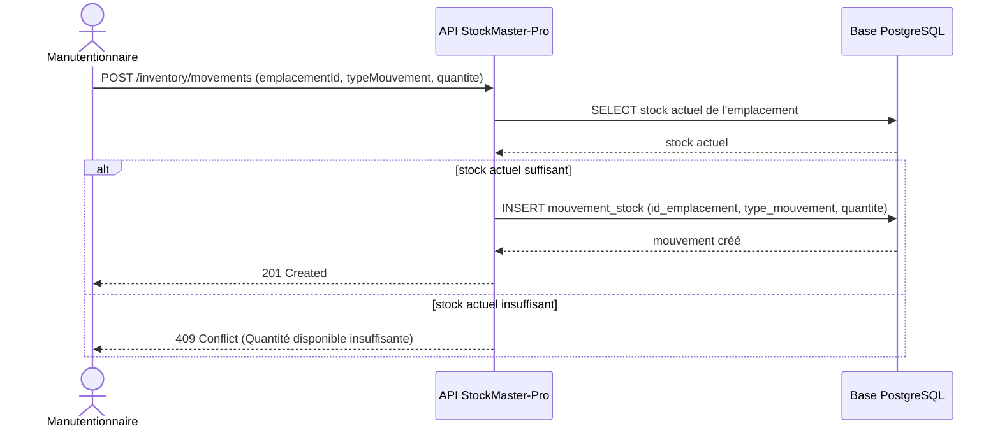

# Architecture comportementale : StockMaster-Pro

## Déclaration d'un mouvement de stock

## Correspondance YAML ↔ SQL

| API (`03_api_contract.yaml`) | Base (`01_database_schema.sql`)  |
| ---------------------------- | -------------------------------- |
| `emplacementId`              | `mouvement_stock.id_emplacement` |
| `typeMouvement`              | `mouvement_stock.type_mouvement` |
| `quantite`                   | `mouvement_stock.quantite`       |
